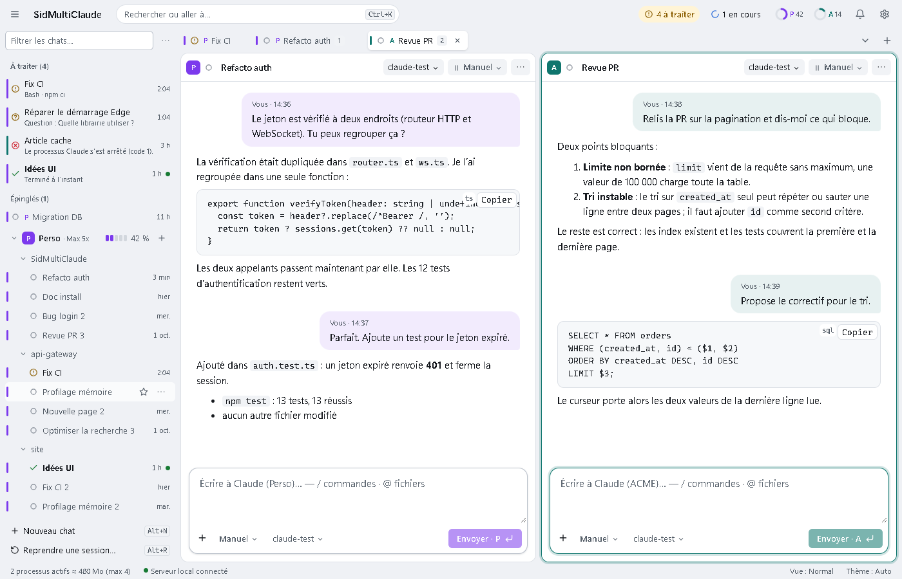
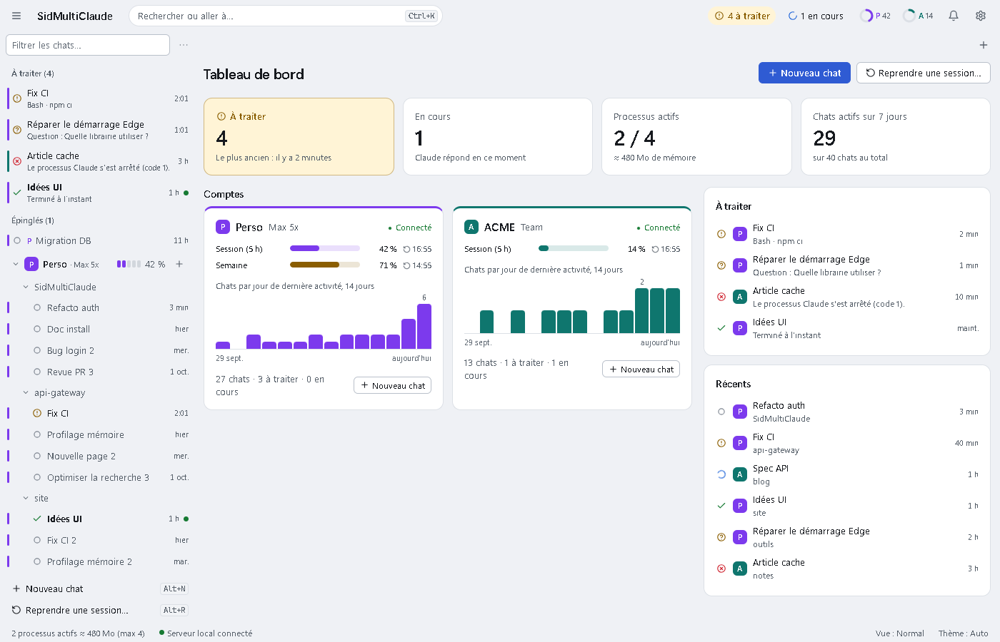
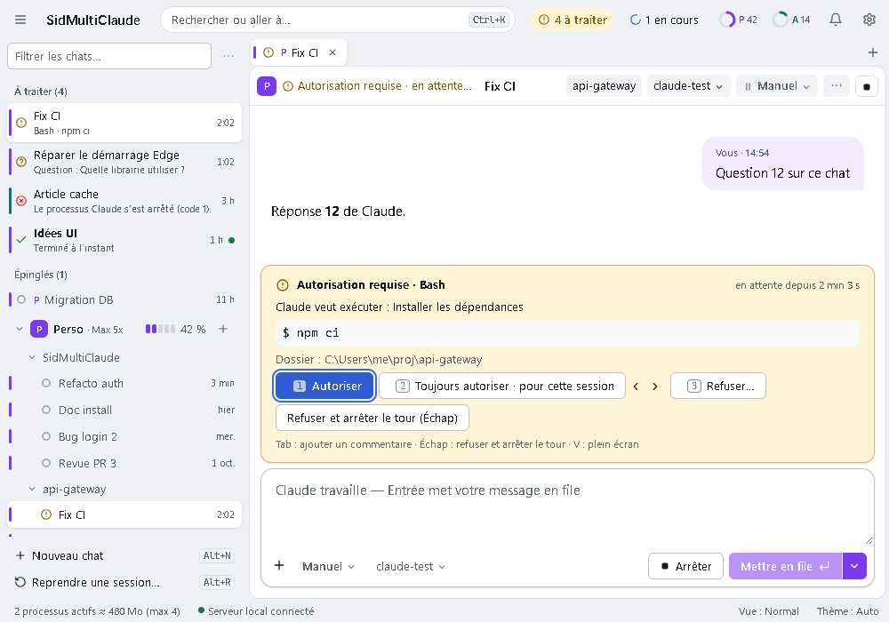
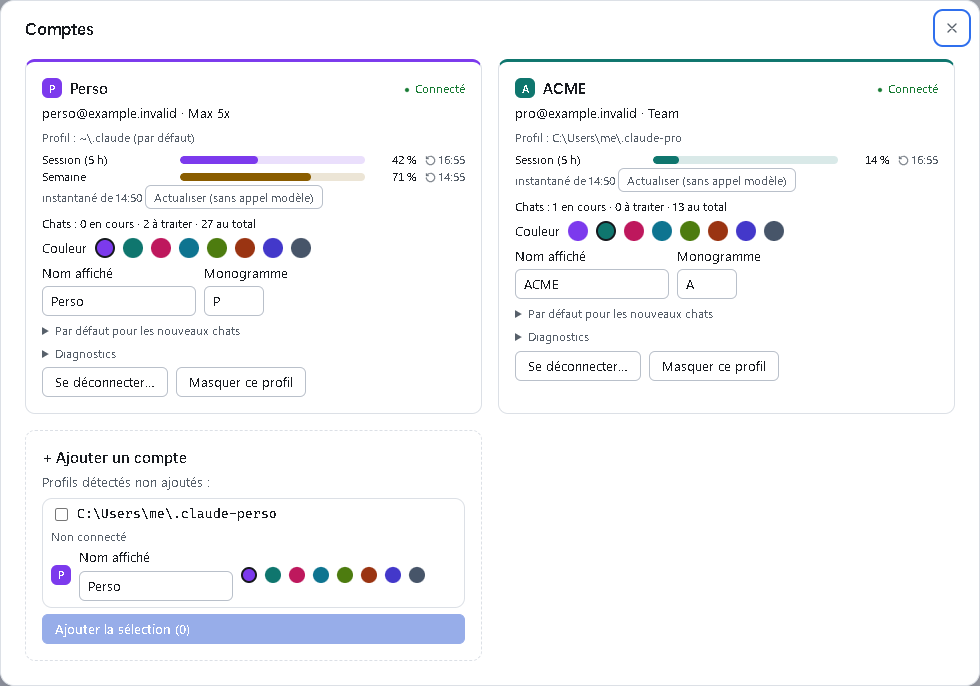

# SidMultiClaude

**Plusieurs comptes Claude Code, une seule fenêtre.** Application Windows locale et légère pour piloter plusieurs comptes Claude Code côte à côte, dans une interface très interactive, sans consommer un token de plus que le terminal.

[](LICENSE)
[](https://nodejs.org)
[](#prérequis)
[](https://github.com/zubulmuk92/SidMultiClaude/actions/workflows/ci.yml)

> Projet indépendant, non affilié à Anthropic. « Claude » et « Claude Code » sont des marques d’Anthropic.

## Aperçu





| File « À traiter » | Comptes |
|---|---|
|  |  |

## Fonctionnalités

- **Multi-comptes** : chaque compte est un profil Claude Code (`~\.claude`, `~\.claude-<nom>`), avec un nom, une couleur et un monogramme visibles partout.
- **Plusieurs chats côte à côte** : onglets, volets, barre latérale groupée par compte et par dossier, sélecteur rapide (`Ctrl+K`).
- **Tableau de bord** : à l’ouverture, les chiffres clés (à traiter, en cours, processus actifs, chats actifs), l’usage et l’activité de chaque compte, les chats à traiter et les plus récents. Il ne lit que ce que la fenêtre connaît déjà : aucune requête, aucun token.
- **File « À traiter »** : toutes les demandes d’autorisation, questions et plans en attente, quel que soit le compte, avec un aperçu rapide depuis la barre latérale.
- **Le vrai Claude Code** : le `claude.exe` installé, piloté par l’Agent SDK d’Anthropic. Mêmes réglages, mêmes outils, mêmes skills, mêmes MCP que dans votre terminal.
- **Zone de saisie complète** : file de messages (« après ce tour »), palette de commandes `/`, mentions `@`, pièces jointes, historique, brouillons conservés.
- **Gestion du cycle de vie** : reprise de sessions existantes, renommage, épinglage, retour en arrière, bifurcation, *Continuer sur un autre compte*, *Ouvrir dans le terminal*.
- **Suivi de l’usage** : jauges d’usage par compte, contexte et état du cache de chaque chat, coût estimé de chaque action qui consomme des tokens.
- **Clavier d’abord** : raccourcis pour tout, compatibles AZERTY et avec les raccourcis réservés d’Edge (`F1` les affiche tous).
- **Léger** : un serveur Node sans étape de build, une fenêtre Edge, un processus `claude.exe` par chat *actif* seulement.

## Pourquoi ?

Utiliser plusieurs comptes Claude Code (personnel et professionnel, par exemple) oblige à jongler entre des terminaux, des variables `CLAUDE_CONFIG_DIR` et des demandes d’autorisation dispersées. Les interfaces tierces, elles, réimplémentent souvent le moteur ou ajoutent des appels de modèle cachés.

SidMultiClaude réunit tous les comptes dans une seule fenêtre en gardant le moteur officiel, intact, et en s’imposant une règle stricte : **ne jamais consommer plus de tokens que Claude Code pour le même travail**.

## Parité de tokens

Mesures réelles (9 octobre 2026, compte Team, modèle `haiku`, Claude Code 2.1.295) :

| Mesure | Résultat |
|---|---|
| Premier message d’un chat | **37 276** tokens d’entrée pour l’application, contre **37 343** pour `claude -p` dans le même dossier |
| Deuxième message, même processus | **37 274** tokens lus depuis le cache, **2 203** écrits (le nouveau tour seulement) |
| Appels cachés | Aucun (pas de titre par IA, sentinelle hors boucle principale à 0) |
| Interruption | 0 token |

Comment c’est garanti :

- **Mêmes requêtes que Claude Code** quand il répond lui-même aux demandes d’autorisation : invite système `claude_code`, sources de réglages `user`, `project` et `local`, mode de permission explicite, aucune option qui changerait les requêtes. Un seul constructeur d’options, vérifié par les tests de parité.
- **Pas d’appel caché** : la génération de titre par IA est désactivée (`CLAUDE_CODE_DISABLE_TERMINAL_TITLE=1`), sauf si vous activez *Réglages › Titres IA*.
- **Le cache reste chaud** : un processus vivant par chat actif, mis en veille seulement après expiration de son cache (1 h par défaut), jamais un cache encore chaud sans votre accord.
- **Coûts annoncés** : réveiller un chat endormi recrée son cache (de l’ordre de tout l’historique) et l’estimation s’affiche avant ; les actions qui coûtent volontairement des tokens portent la mention « modèle », précédée d’une icône d’éclair (`/compact`, changement de modèle quand le cache est chaud…).
- **Sentinelle** : le pied de chaque tour indique les tokens consommés hors de la boucle principale (sous-agents, outils) ; sur un tour simple, ce nombre reste à 0.
- Par rapport à `claude -p` sans hôte, l’application ajoute les 3 outils d’interaction que Claude Code n’offre que lorsqu’un hôte répond aux demandes (AskUserQuestion, EnterPlanMode, ExitPlanMode) : environ +17 tokens par requête avec un abonnement, où ils sont différés derrière ToolSearch.
- Pour les comptes autres que le profil par défaut, le `~\.claude\CLAUDE.md` du profil par défaut (que Claude Code chargerait comme instructions d’un dossier parent) est exclu par défaut. Réglable par compte dans *Comptes*.

Méthode et détails : [docs/PARITE-TOKENS.md](docs/PARITE-TOKENS.md).

## Prérequis

- Windows 10 ou 11 (x64).
- [Node.js](https://nodejs.org) **24.16 ou plus récent** (il exécute directement les fichiers `.ts`) et npm 11.
- **Claude Code natif** installé et connecté au moins une fois (`claude.exe`, en général `%USERPROFILE%\.local\bin\claude.exe`).
- Microsoft Edge (présent d’office) ou Google Chrome.
- Facultatif : le compilateur C# fourni avec Windows (`%WINDIR%\Microsoft.NET\Framework64\v4.0.30319\csc.exe`), pour deux petits utilitaires (voir [Installation](#installation)).

## Installation

```powershell
git clone https://github.com/zubulmuk92/SidMultiClaude.git
cd SidMultiClaude
npm ci --omit=optional --ignore-scripts
```

- `--omit=optional` évite le binaire Claude Code embarqué dans le SDK (environ 244 Mo) : l’application utilise votre `claude.exe` installé.
- `--ignore-scripts` : aucune dépendance n’a besoin d’un script d’installation, ce qui réduit les risques côté chaîne d’approvisionnement. Le fichier `.npmrc` applique ces deux options par défaut.
- Toutes les versions sont épinglées exactement (`package.json`, `package-lock.json`).
- Binaire embarqué en secours (facultatif) : `npm run fetch-bundled-cli`, puis *Réglages › Binaire Claude › embarqué*. Un `npm ci` ultérieur le retire : relancez alors la commande.

### Raccourcis Bureau et menu Démarrer (facultatif)

```powershell
npm run install-app
```

- Crée les raccourcis sur le Bureau et dans le menu Démarrer.
- Si `csc.exe` fonctionne, compile à partir des sources du dépôt (`launcher\*.cs`) deux utilitaires **facultatifs** et enregistre leur empreinte SHA-256 :
  - `SidMultiClaude.exe` : lanceur sans fenêtre de console, qui relance le serveur après un arrêt inattendu (3 fois au plus en 60 s) ;
  - `jobrun.exe` : place chaque `claude.exe` dans un *Job* Windows, pour que tous ses sous-processus s’arrêtent avec lui.
- **L’application fonctionne pleinement sans eux** (compilateur absent, antivirus ou AppLocker) : isolation « Simple » (arrêt par arbre de processus avec `taskkill /T /F`) et raccourcis vers un lanceur de secours sans console qui exécute `node src/server/main.ts --open`.

## Démarrage rapide

```powershell
npm start
```

1. La fenêtre *Bienvenue · Ajoutez vos comptes Claude* liste vos profils Claude Code (`~\.claude`, `~\.claude-pro`, …) : les profils connectés sont présélectionnés. Choisissez un nom et une couleur, puis *Ajouter la sélection*.
2. `Alt+N` (ou *Nouveau chat*) démarre un chat sur le compte et le dossier de votre choix.
3. `Ctrl+K` retrouve n’importe quel chat ; le volet *À traiter* regroupe les demandes d’autorisation en attente.
4. `F1` affiche tous les raccourcis.

`npm start` démarre le serveur et ouvre la fenêtre ; si l’application tourne déjà, une nouvelle fenêtre s’ouvre simplement. `npm run dev` relance le serveur à chaque modification du code.

## Utilisation

Fermer la fenêtre n’arrête pas les chats en cours : le serveur reste actif tant qu’un chat travaille ou attend une réponse, et s’arrête 10 minutes après la fermeture de la dernière fenêtre quand plus rien n’est actif. Rouvrir la fenêtre ne coûte donc aucun token.

### Raccourcis principaux

| Raccourci | Action |
|---|---|
| `Ctrl+K` | Sélecteur rapide (préfixes `>` `c:` `d:` `e:`) |
| `Alt+N` · `Alt+R` · `Alt+C` | Nouveau chat · Reprendre une session · Comptes |
| `Alt+A` | Prochain « À traiter » (le plus ancien d’abord) |
| `Alt+1…9` · `Alt+PgSuiv` · `Alt+PgPréc` | Onglet n · suivant · précédent |
| `Alt+W` · `Alt+Z` · `Alt+B` | Fermer l’onglet · le rouvrir · afficher ou masquer la barre latérale |
| `Entrée` · `Maj+Entrée` | Envoyer (ou intégrer au tour en cours) · nouvelle ligne |
| `Alt+Entrée` | Envoyer après le tour en cours |
| `Échap` · `Échap Échap` | Interrompre (la file est gardée) · Revenir à un message précédent |
| `Alt+M` · `Alt+P` | Mode de permission · modèle et effort |
| `1`/`O` · `2`/`T` · `3`/`N` | Sur une demande : Autoriser · Toujours · Refuser… |
| `F6` · `F1` · `Ctrl+,` | Changer de région · aide · réglages |

### Conservation des conversations

Claude Code supprime les transcriptions inactives après `cleanupPeriodDays` jours (**30 par défaut**), y compris celles créées par l’application. L’application vous prévient (« ⌛ Supprimé dans n j » à partir du 25e jour, nombre de chats concernés dans *Comptes*) mais ne modifie jamais vos réglages. Pour conserver vos conversations plus longtemps, ajoutez vous-même cette ligne au `settings.json` de chaque profil (`~\.claude\settings.json`, `~\.claude-<nom>\settings.json`) :

```json
"cleanupPeriodDays": 3650
```

## Comptes

- **Un compte = un profil Claude Code.** Le profil par défaut (`~\.claude`) est utilisé tel quel ; les autres sont des dossiers `~\.claude-<nom>` (variable `CLAUDE_CONFIG_DIR`).
- **Premier lancement** : la fenêtre de bienvenue, puis le panneau *Comptes* (`Alt+C`), proposent les profils trouvés ; rien n’est ajouté sans votre confirmation.
- **Connexion** : elle passe par `claude.exe auth login`, c’est-à-dire la page de connexion d’Anthropic. L’application ne voit jamais vos identifiants.
- **Continuer sur un autre compte** crée une copie du chat sur le compte choisi ; l’original reste intact. Le premier message relit tout l’historique sans cache sur ce compte (l’estimation s’affiche). Les instructions du compte d’origine peuvent rester actives dans la copie jusqu’à la prochaine compaction : ce point n’est pas vérifié et la boîte de dialogue le signale.
- **Sessions SDK** : les chats créés par l’application n’apparaissent pas dans le sélecteur `/resume` du terminal, mais se reprennent par identifiant (*Copier la commande* ou *Ouvrir dans le terminal*).
- **Comptes d’organisation (siège Team ou Enterprise)** : piloter un siège d’organisation depuis une interface personnelle relève de votre responsabilité ; vérifiez auprès de l’administrateur de l’organisation que cet usage est accepté. Des réglages gérés par l’organisation (par exemple `forceLoginOrgUUID`) peuvent s’appliquer au profil.

## Sécurité et confidentialité

- **Tout reste sur votre machine.** Le serveur n’écoute que `127.0.0.1`, sans cookie ; la fenêtre s’authentifie avec un code d’amorçage à usage unique, puis un jeton d’appareil.
- **Aucun jeton n’est lu, copié ni affiché.** `.credentials.json` n’est consulté que pour savoir s’il existe ; les fichiers `*.key` ne sont jamais ouverts.
- **Aucune écriture dans un profil Claude** (`~\.claude`, `~\.claude-*`, `~\.claude.json`) par l’application : seul Claude Code y écrit (transcriptions, renommage, suppression, bifurcation, connexion).
- **Les conversations restent dans le stockage de Claude Code.** L’application ne garde que des métadonnées légères dans `%LOCALAPPDATA%\SidMultiClaude\` (configuration, état de l’interface, brouillons, index, journaux, profil du navigateur) : supprimer ce dossier ne fait perdre aucune conversation.
- Les journaux ne contiennent pas le contenu des messages et masquent les secrets. Les notifications restent minimales : jamais le texte d’un message, jamais de bouton « Autoriser ».
- **Aucun envoi automatique** : pas de reprise automatique après une limite d’usage, pas de message programmé. L’application utilise Claude Code sans modification et s’identifie honnêtement (`sidmulticlaude/0.1.0`).

Signaler une vulnérabilité : voir [SECURITY.md](SECURITY.md).

## Architecture

Un serveur Node 24 local (seul composant qui pilote Claude Code) et une fenêtre Edge en mode `--app`, reliés par un WebSocket authentifié. Le serveur est en TypeScript exécuté directement par Node ; l’interface est en JavaScript + JSDoc (Preact, htm, signals), sans étape de build.

```
Fenêtre Edge --app ──WebSocket──▶ Serveur Node (127.0.0.1) ──Agent SDK──▶ claude.exe (un par chat actif)
                                         │                                      │
                                         ▼                                      ▼
                         %LOCALAPPDATA%\SidMultiClaude\            Profils Claude Code (~\.claude, ~\.claude-*)
```

Détails : [docs/ARCHITECTURE.md](docs/ARCHITECTURE.md). Références de conception (en anglais) : [docs/design/](docs/design/).

## Tests

| Commande | Contenu | Tokens |
|---|---|---|
| `npm run check` | Vérification TypeScript 7 du serveur et de l’interface (JS + JSDoc) | 0 |
| `npm test` | Tests unitaires (`node --test`) | 0 |
| `npm run test:int` | Intégration : vrai SDK + faux Claude Code (`test/fakes/fake-claude.mjs`) | 0 |
| `npm run test:parity` | Parité : options, arguments et environnement, corps de requête comparés via une fausse API | 0 |
| `npm run test:contract` | Contrat avec le vrai `claude.exe`, sur un profil temporaire **déconnecté** (environ 30 s ; à relancer après chaque mise à jour de Claude Code) | 0 |
| `npm run test:browser` | Composants de l’interface dans Edge (sans serveur réel) | 0 |
| `npm run test:e2e` | Bout en bout : vrai serveur + faux Claude Code, Edge installé piloté par playwright-core, sans téléchargement de navigateur | 0 |
| `npm run vendor-audit` | Les fichiers servis au navigateur correspondent exactement au graphe d’imports | 0 |
| `npm run smoke` | Essai réel, manuel et volontaire (`$env:SMC_SMOKE='1'`) : vrai profil, modèle `haiku`, 8 requêtes au maximum | quelques requêtes |

Les tests ne touchent jamais un vrai profil Claude : ils créent des profils jetables sous `%TEMP%` (`test/helpers/tmp-profile.ts`). Les enregistrements de référence (`test/fixtures/`) ne gardent que la **structure** de vraies sessions : tout texte libre y est remplacé par un texte synthétique et le contexte injecté (hooks, `CLAUDE.md`, environnement) par des marqueurs (`scripts/sanitize-frames.mjs`, qui vérifie ensuite qu’aucune donnée personnelle ne subsiste).

La CI GitHub (Windows, Node 24) exécute `check`, les tests unitaires, l’intégration et `vendor-audit`. Les suites qui demandent le vrai `claude.exe` ou Edge (`test:parity`, `test:contract`, `test:browser`, `test:e2e`) se lancent en local.

## Limites connues

- **« Restaurer la conversation » n’est enregistrée qu’avec le message suivant.** Claude Code n’écrit la nouvelle branche dans la transcription qu’au premier message envoyé après le retour en arrière. Si le chat est mis en veille ou fermé avant ce message, la reprise suivante (dans l’application comme dans le terminal) continue l’ancienne branche : refaites alors le retour en arrière.
- **Usage du compte** : actualisé au plus une fois toutes les 10 minutes par compte, et seulement à votre demande ; entre-temps, la dernière valeur connue s’affiche.
- **Modèles** : seuls les alias (`opus`, `sonnet`, `haiku`, `fable`) et les modèles du catalogue du compte sont acceptés. Un modèle retiré du catalogue (mise à jour de Claude Code) est ignoré au démarrage suivant du chat, qui reprend le modèle par défaut.
- **Mémoire** : environ 450 Mo par chat actif ; d’où la limite de 4 chats actifs par défaut (réglable de 2 à 8). Sous 1,5 Go de mémoire libre, aucun chat supplémentaire ne démarre sans en mettre un autre en veille, ou sans dépasser la limite à votre demande.
- **Windows uniquement** pour l’instant.

## Contribuer

Les contributions sont bienvenues : lisez [CONTRIBUTING.md](CONTRIBUTING.md) (prérequis, commandes, niveaux de tests, style de code). Règle absolue : **aucun test automatisé n’appelle de modèle**. Historique des versions : [CHANGELOG.md](CHANGELOG.md).

## Licence

[MIT](LICENSE) © 2026 zubulmuk92
